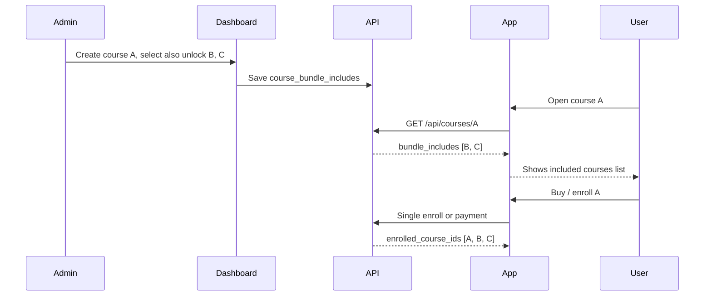

# Course bundle includes — Admin, API, Flutter

> **Purpose:** Courses are created **normally**. When an admin creates or edits a course, they choose **which other courses also open** if a user buys that course. The **admin dashboard** owns that configuration. The **API** exposes it. The **server** enrolls the user in all linked courses on successful purchase/enrollment. The **Flutter app** only displays the list and uses standard enroll/payment flows.

---

## How it works

1. Admin creates a course like any other course (title, price, description, lessons, etc.).
2. On the same form, admin **multi-selects other courses** that should unlock when someone buys this course.
3. User buys/enrolls in **Course A** → backend opens **Course A** plus every course the admin linked to A.
4. Admin can change linked courses anytime in the dashboard (policy for existing buyers is your choice — see edge cases).

There is **no** special “track”, “tier”, or ladder in the product model — only normal courses and optional **included courses**.

---

## Admin dashboard

### Course create / edit

| Field | Notes |
|--------|--------|
| Standard course fields | Same as today |
| **Also unlock these courses** (multi-select) | Other published courses included with this purchase |

**Recommended rules:**

- A course cannot include itself.
- Only **published** courses in the picker (or warn on draft).
- Removing a link affects **new** purchases unless you run a migration (document your policy).
- Deleting a course removes it from other courses’ include lists (or block delete while referenced).

### Suggested database

```text
course_bundle_includes
  id
  parent_course_id    -- course the user pays for
  included_course_id  -- course that also opens
  sort_order          -- optional display order in the app
  created_at

UNIQUE (parent_course_id, included_course_id)
```

---

## API contract

### Public course responses

Include on **`GET /api/courses/:id`** and anywhere the app loads course details (list cards optional):

```json
{
  "id": "uuid-parent",
  "title": "Advanced Sales",
  "description": "Course description text for the About tab.",
  "price": 750,
  "is_free": false,
  "is_enrolled": false,
  "bundle_includes": [
    {
      "course_id": "uuid-b",
      "title": "Introduction to Sales",
      "title_ar": "مقدمة في المبيعات",
      "thumbnail": "/uploads/optional.jpg",
      "sort_order": 1
    },
    {
      "course_id": "uuid-c",
      "title": "Customer Psychology",
      "title_ar": "علم نفس العميل",
      "sort_order": 2
    }
  ]
}
```

| Field | Source | Flutter |
|--------|--------|---------|
| `bundle_includes` | Admin-selected links | Green “included courses” banner on course details |
| `bundle_includes[].course_id` | DB | Identity |
| `bundle_includes[].title` / `title_ar` | Included course record | List labels (AR prefers `title_ar`) |
| `description` | Admin | **About** tab text |

- If `bundle_includes` is **empty or missing**, do not show the bundle banner.
- **Do not** compute includes in the app from tiers, categories, or price — **only** what the API returns.

### Admin API (dashboard)

| Method | Path | Body / action |
|--------|------|----------------|
| `GET` | `/api/admin/courses/:id/bundle-includes` | Return current links |
| `PUT` | `/api/admin/courses/:id/bundle-includes` | `{ "included_course_ids": ["uuid-b", "uuid-c"] }` replaces full set |

Validate that IDs exist and are allowed to be sold.

---

## Enrollment (server only)

After success on any path:

| Path | When |
|------|------|
| `POST /api/courses/:id/enroll` | Free enrollment |
| Payment confirm | Paid checkout |
| Enrollment request approved | Library / WhatsApp / manual approval |

```text
onSuccessfulEnrollment(userId, purchasedCourseId):
  enrollIdempotent(userId, purchasedCourseId)
  for each row in course_bundle_includes where parent = purchasedCourseId:
    enrollIdempotent(userId, included_course_id)
    unlockLessons(userId, included_course_id)
```

- Flutter calls enroll/pay **once** for the purchased course.
- Flutter **must not** call enroll separately for each included course.

### Recommended response

```json
{
  "success": true,
  "data": {
    "enrolled_course_ids": ["uuid-parent", "uuid-b", "uuid-c"],
    "message": "Courses are now available on your account."
  }
}
```

The app may show a message when `enrolled_course_ids.length > 1`.

---

## Flutter app (current behavior)

| Piece | File | Behavior |
|--------|------|----------|
| Load course | `courses_service.dart` → `getCourseDetails` | `GET /api/courses/:id` |
| About tab | `course_details_screen.dart` | `description` from API |
| Included courses banner | `skill_track_bundle_banner.dart` | Reads `bundle_includes` (UI strings are localized; **list is API**) |
| Parser | `skill_track_utils.dart` → `bundleIncludesFromCourse` | Reads `course['bundle_includes']` |

**Production requirement:** API always sends `bundle_includes` when admin configured links. The app has a **local fallback catalog** for old demos — ignore that for production; fix the API instead.

**Future rename (optional):** Widget/util names still say `skill_track_*` in code; behavior is already driven by `bundle_includes` only.

---

## Flow



---

## Edge cases

| Case | Behavior |
|------|----------|
| No courses selected | `bundle_includes: []` — single-course purchase only |
| User already owns B | Idempotent enroll — no error |
| Admin removes C after purchase | User usually keeps C (unless you revoke) |
| Included course unpublished | Omit from API or filter on read |
| Normal course (no links) | Standard single enrollment |

---

## Backend checklist

- [ ] Table `course_bundle_includes` (or equivalent)
- [ ] Multi-select on admin course form
- [ ] `bundle_includes` on `GET /api/courses/:id`
- [ ] Bundle enroll on server after pay/enroll/approve
- [ ] `enrolled_course_ids` in success responses
- [ ] QA with dashboard change → API → app banner updates

---

## QA

See [`docs/COURSE_BUNDLE_INCLUDES_QA.md`](COURSE_BUNDLE_INCLUDES_QA.md).
